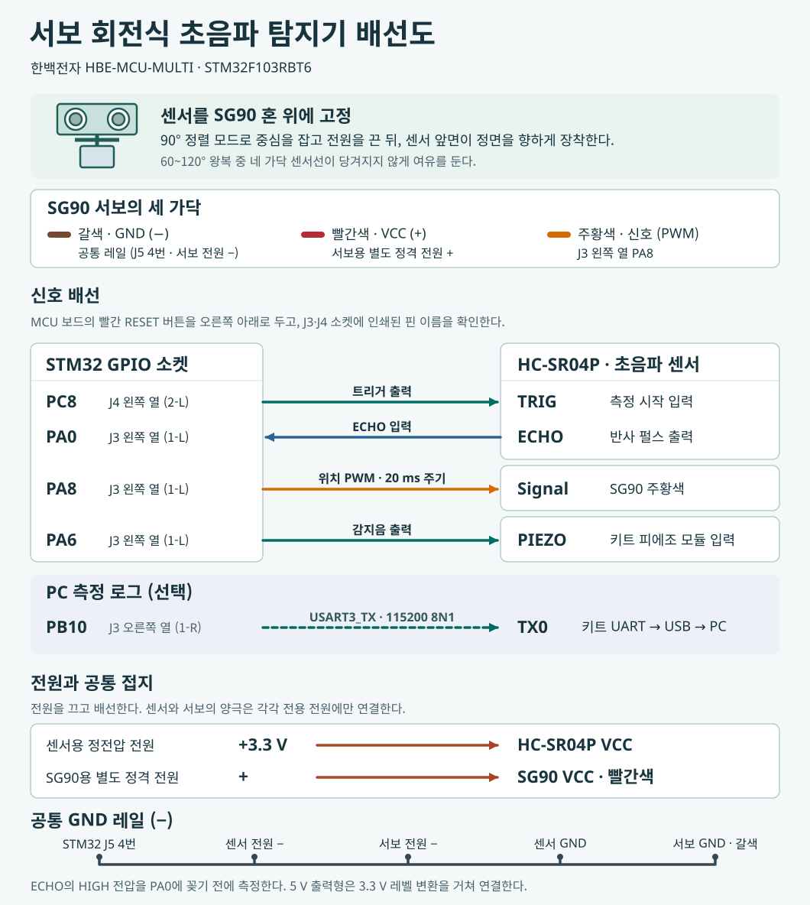
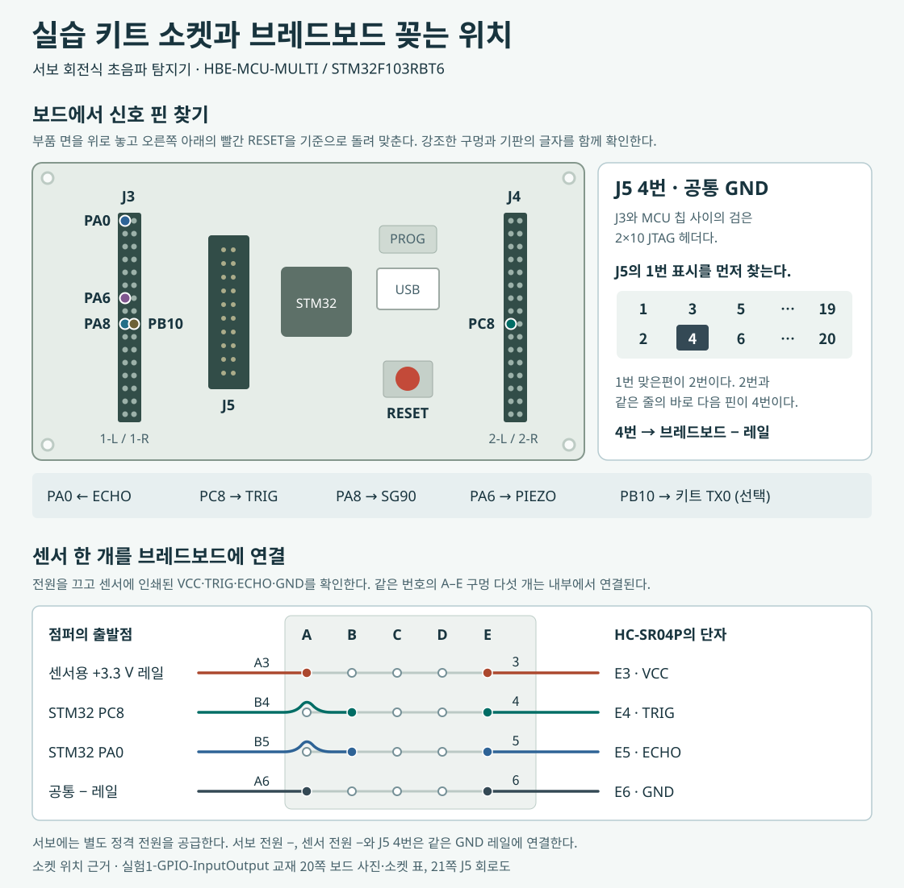
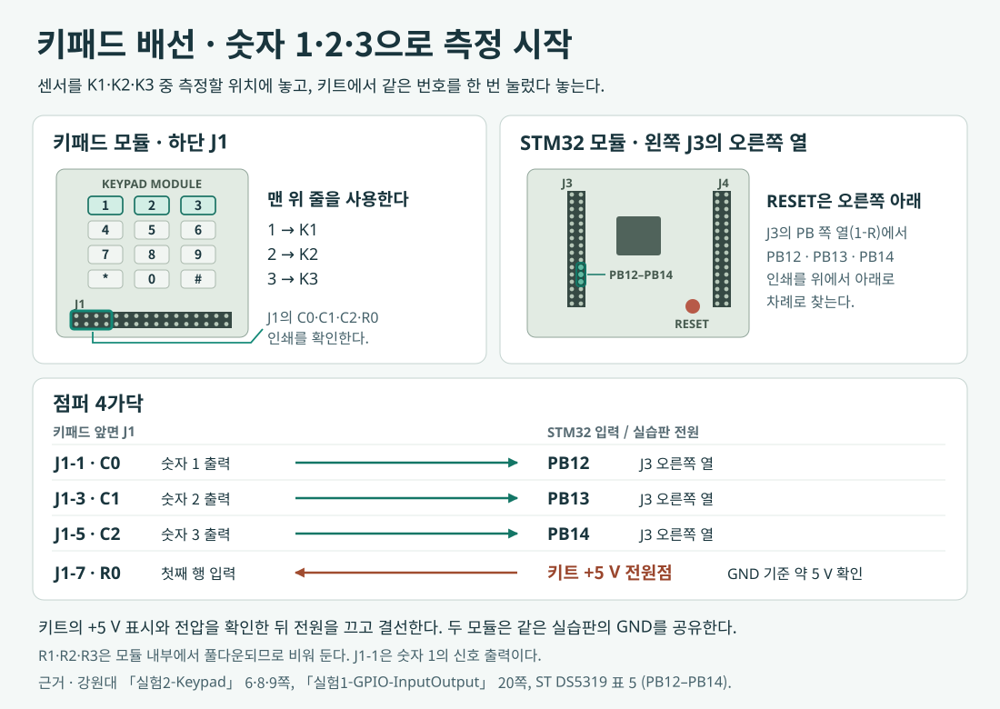
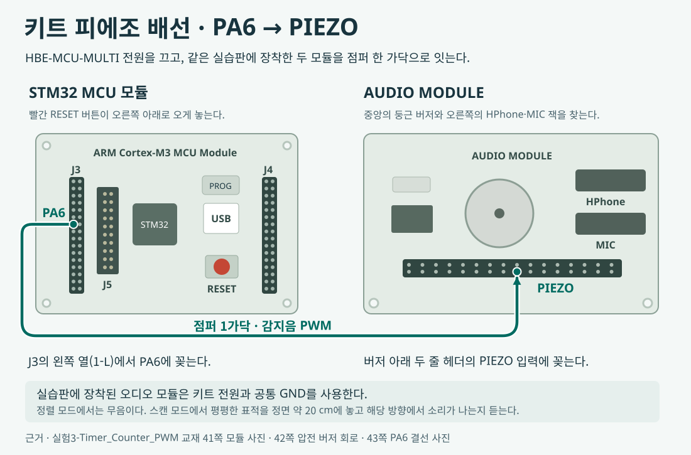

# 서보 회전식 초음파 탐지기

STM32는 서보 위의 HC-SR04P를 정면에 두고 대기한다. 모형에 센서를 고정하고 **실습판 키패드 1(K1)·2(K2)·3(K3)** 중 해당 키를 누르면 서보가 한 번 좌우를 탐색한다. PC에는 각도별 반사점이 실시간으로 쌓인다. 스캔 중 **30 cm 이내**에서 반사를 받으면 피에조가 울리고 **35 cm 이상**이거나 무응답이면 멎는다. 한 번의 탐색이 끝나면 서보가 정면으로 돌아오고 피에조가 멎는다.

[90° 정렬용 DFU 다운로드](https://github.com/tokengeoji/mcu/raw/refs/heads/dev/firmware/SweepCenter.dfu) · [스캔용 DFU 다운로드](https://github.com/tokengeoji/mcu/raw/refs/heads/dev/firmware/SweepScan.dfu) · [IAR 프로젝트](stm32/SweepScan.eww) · [팀 노션의 설계 원문](https://app.notion.com/p/4253c6661b7d8149a666e968a2ce0bc0)

## PC에서 실시간 지도 보기

`C:\mcu_project\project`에서 `.\pc_mapper\start-mapper.cmd`를 실행한다. PC 지도에서 **연결** 메뉴의 UART 포트를 선택한다. 포트가 하나면 자동 연결된다. 모형에서 먼저 측정할 곳에 센서를 놓고 실습판에서 해당 숫자를 누른다. 같은 위치를 다시 측정하면 완료 시 그 지점의 기록이 갱신된다. [PC 지도 실행·배치 안내](pc_mapper/README.md) · [키패드 배선도](docs/keypad-wiring.svg)

## 배선

**SG90 서보의 세 가닥**은 전원을 끄고 아래 표대로 연결한다. [SG90 선 색상 배선 사양](https://tams.informatik.uni-hamburg.de/lehre/2019ss/vorlesung/es/doc/sg90.pdf)

| 서보 선 색 | 역할 | 이 키트에서 연결할 곳 |
| --- | --- | --- |
| **갈색** | GND (−) | 브레드보드 공통 GND 레일. **서보 전원 −**와 **STM32 J5 4번**도 이 레일에 연결 |
| **빨간색** | VCC (+) | **서보용 별도 정격 전원 +**. 센서용 3.3 V 레일과 분리 |
| **주황색** | 제어 신호 (PWM) | **STM32 PA8** · J3 왼쪽 열 (1-L) |

그림의 화살표는 신호 방향이다. [전체 배선도](docs/wiring.svg) · [부저 점퍼 위치](docs/buzzer-wiring.svg) · [소켓·브레드보드 확대도](docs/socket-guide.svg) · [인쇄용 배선도 PDF](docs/wiring.pdf)



| STM32 또는 전원 쪽 | 연결할 단자 | 역할 |
| --- | --- | --- |
| PC8 · J4 왼쪽 열 | HC-SR04P TRIG | STM32가 12 µs 측정 시작 펄스 출력 |
| PA0 · J3 왼쪽 열 | HC-SR04P ECHO | 센서가 보낸 펄스 폭을 TIM2로 측정 |
| PA8 · J3 왼쪽 열 | SG90 주황색 (Signal) | TIM1이 20 ms 주기로 서보 위치 명령 |
| PA6 · J3 왼쪽 열 | AUDIO MODULE의 PIEZO 입력 | 점퍼 1가닥. TIM3_CH1에서 감지 중 약 1,024 Hz 출력 |
| 센서용 3.3 V 정전압 전원 + | HC-SR04P VCC | 3.3 V 구동형 센서 기준 |
| 서보용 별도 정격 전원 + | SG90 빨간색 (VCC) | 지급품 정격과 구동 전류에 맞춰 공급 |
| STM32 J5 4번 GND | SG90 갈색 (GND), 센서 GND, 두 전원 음극 | 브레드보드의 같은 접지 레일로 연결 |
| PB10 · J3 오른쪽 열 (선택) | 키트 UART 모듈 **TX0** | PC로 측정 로그 전송. 일반 3.3 V USB–TTL 어댑터는 RX와 공통 GND 사용 |

빨간 RESET 버튼을 오른쪽 아래에 두고 J3·J4 소켓의 기판 인쇄를 읽는다. 두 외부 전원의 양극은 분리한다. 센서 ECHO의 HIGH가 3.3 V인지 확인한 뒤 PA0에 연결한다. 5 V 출력형은 레벨 변환이 필요하다. TowerPro SG90 Digital의 공칭 전압은 4.8 V다. [STM32 데이터시트](https://www.st.com/resource/en/datasheet/stm32f103rb.pdf) · [SG90 제조사 사양](https://towerpro.com.tw/product/sg90-7/)



### 키패드 1·2·3 배선

전원을 끄고 **HBE KEYPAD MODULE** 앞면의 J1에 아래 네 가닥을 연결한다. 한 실습판의 공통 접지를 기준으로 한다. 첫 행만 활성화하므로 다른 행에는 점퍼가 필요 없다. 교재 회로의 5 V 열 출력은 STM32의 5 V 허용 디지털 입력 PB12·PB13·PB14로 받는다. [STM32F103RB 데이터시트 표 5](https://www.st.com/resource/en/datasheet/stm32f103rb.pdf)

| 키패드 J1 앞면 | 연결할 곳 | 역할 |
| --- | --- | --- |
| J1-7 · R0 | 실습판에서 +5 V로 확인한 전원 단자 | 키 1·2·3이 있는 첫 행 활성화 |
| J1-1 · C0 | STM32 J3 오른쪽 열 PB12 | 1 → K1 |
| J1-3 · C1 | STM32 J3 오른쪽 열 PB13 | 2 → K2 |
| J1-5 · C2 | STM32 J3 오른쪽 열 PB14 | 3 → K3 |



### 부저 점퍼 연결

전원을 끄고 **STM32의 J3 왼쪽 열 `PA6`**에서 **AUDIO MODULE의 `PIEZO`**까지 점퍼 한 가닥을 꽂는다. 오디오 모듈의 `HPhone`·`MIC` 잭이 오른쪽으로 보일 때, 가운데 둥근 부저 바로 아래의 긴 두 줄 헤더에서 `PIEZO` 인쇄를 찾는다. 두 모듈이 같은 실습판에 장착된 구성에서는 부저의 전원과 GND가 실습판을 통해 연결된다. 결선 근거는 실습 교재 《실험3-Timer_Counter_PWM》 41~43쪽이다.



## 처음 켤 때

| 순서 | 할 일 | 통과 기준 |
| --- | --- | --- |
| 1. 서보 정렬 | 서보 몸체를 고정하고 혼을 분리한다. `firmware/SweepCenter.dfu`를 올리고 RESET을 누른다. | 축이 중앙 명령 위치에 머문다. 이미 중앙이면 움직임이 작을 수 있다. |
| 2. 센서 장착 | 전원을 끄고 혼과 센서를 정면으로 고정한다. 센서 선 네 가닥에 회전 여유를 둔다. | 센서의 둥근 송수신부가 정면을 향하고 양 끝에서 전선이 당겨지지 않는다. |
| 3. 모터 시험 | 새 `firmware/SweepScan.dfu`를 올리고 RESET한다. K1에 센서를 고정하고 키패드 **1**을 한 번 누른다. | 대기 중에는 정면 90°를 유지한다. 키를 누르면 0°로 이동해 **0° → 180°**를 5°씩 측정하고 정면 90°로 복귀한다. |
| 4. 거리·부저 시험 | 넓고 평평한 판을 센서 정면 약 **20 cm**에 놓고 키를 누른다. 판을 **40 cm**로 옮겨 같은 키로 재측정한다. | 판을 향할 때 20 cm에서 소리가 나고 40 cm 또는 무반사에서 멎는다. |

### 서보와 부저가 모두 조용할 때

먼저 [부품별 진단용 SweepCheck.dfu](firmware/SweepCheck.dfu)를 사용한다. 이 파일은 기동 직후 **표적 없이도** 부저와 서보를 차례로 시험하고, 그다음 센서를 정면에 고정해 거리만 잰다.

| RESET 후 관찰 순서 | 정상 동작 | 관찰 결과로 확인할 곳 |
| --- | --- | --- |
| 1 · 부저 | 1,024 Hz의 짧은 소리가 두 번 난다. | 서보는 움직이는데 시작음만 없으면 J3 `PA6`부터 오디오 모듈 `PIEZO`까지 점퍼 양 끝을 확인한다. |
| 2 · 서보 | 60° → 120° → 90°를 명령하고 각 위치에서 약 1초 기다린다. | 시작음은 들리는데 축이 멈춰 있으면 주황색 선의 PA8, 빨간색·갈색 사이 서보 전압, 갈색과 키트의 공통 GND를 확인한다. |
| 3 · 초음파 | 정면 90°에 고정된다. 판을 20 cm에 두면 부저가 켜지고 40 cm로 옮기면 꺼진다. | 두 시작음은 들렸는데 판에 반응하지 않으면 위 표의 PC8·PA0와 센서 전원을 확인한다. 선택형 UART의 마지막 값 `-1`은 무효 측정이다. |

진단용에서 시작음과 서보 이동이 모두 없으면 DfuSe의 **Internal Flash** 전송·검증 결과를 확인한다. **PROG에서 손을 뗀 채 RESET**을 누른 후에도 장치가 계속 `STM Device in DFU Mode`로 보이면 PROG를 누르지 않고 키트 전원을 다시 켠다. 진단이 끝나면 [키패드용 SweepScan.dfu](firmware/SweepScan.dfu)를 올린다.

### 왼쪽이 짧을 때 서보 끝각 맞추기

정면과 양쪽 90°를 종이에 표시해 두고 **정면 → 짧은 펄스 끝 → 긴 펄스 끝** 세 위치를 직접 맞춘다. 기본 펄스는 기존 1,000/1,500/2,000 µs에서 **950/1,500/2,000 µs**로 바뀌었다. 짧은 펄스가 왼쪽인 장착을 기준으로 잡았다. 보정 중 실제로 어느 쪽으로 움직이는지 보고 부족한 쪽만 조절한다.

1. 새 `SweepScan.dfu`와 PC 지도를 실행한다. **키패드 1과 3을 동시에 누른 채 RESET**을 눌렀다 놓고, GUI 하단에 `서보 90° 보정`이 보이면 키에서 손을 뗀다.
2. 90° 단계에서 실제 정면을 확인한다. 이미 맞으면 **2**를 한 번 눌러 **0°** 단계로 간다. 각 단계에서 **1**은 펄스를 25 µs 줄이고 **3**은 25 µs 늘린다. 한 번씩 눌렀다 떼며 각도기 표시를 확인한다.
3. 0° 단계가 실제 왼쪽이면 **1**을 한 번씩 눌러 정면에서 왼쪽 90° 표시에 맞춘다. 오른쪽이 이미 맞는 상태로 나오면 이 단계를 그대로 통과하고, 이어지는 180° 단계에서 **3**으로 왼쪽을 넓힌다. **2**는 현재 값을 확정하고 다음 단계로 넘어간다.
4. 180° 단계에서 **2**를 누르면 정면으로 돌아가며 세 값을 저장한다. 다음 부팅부터 정상 스캔에 적용된다. 마지막 1 KiB 플래시 페이지에 달라진 값만 추가하며 최대 102회 저장한다. 저장 공간 부족·쓰기 실패 시 GUI에 이번 전원 주기에만 적용된다고 표시한다.

센서선이 당기거나, 축이 더 움직이지 않는데 모터가 계속 웅거리면 즉시 직전 펄스로 되돌린다. 정렬과 간섭을 확인해도 실물 가동범위가 180°보다 작으면 양쪽 90°를 모두 얻으려면 180° 사양의 서보가 필요하다. [TowerPro의 SG90 가동범위 안내](https://towerpro.com.tw/product/sg90-7/)

**키트에 DFU 올리기** · MCU 모듈의 USB를 PC에 연결한다. PROG를 누른 채 MCU 전원을 켜고, DfuSe Demo에서 인식된 키트와 파일 이름을 확인한다. **Choose → Upgrade**를 실행한 뒤 성공 표시를 확인하고 RESET을 누른다. 정렬용과 스캔용은 같은 애플리케이션 주소 `0x08003000`에 차례로 기록한다.

**수치로 확인하기** · 키트 UART 모듈을 PC에 연결하고 해당 COM 포트를 **115200 baud, 8N1, 흐름 제어 없음**으로 연다. 스캔 모드에서 `SCAN,42,1,90,201`은 42번 측정, 감지 켜짐, 명령각 90°, 거리 201 mm라는 예시다. 마지막 값 `-1`은 유효한 반사가 없다는 뜻이다. 30 cm 초과~35 cm 미만에서는 직전 감지 상태를 유지한다. 고정된 물체라도 센서가 다른 방향을 보면 부저가 멎을 수 있다.

| 관찰한 현상 | 먼저 확인할 곳 |
| --- | --- |
| 중앙에서 계속 멈춘다 | `SweepScan.dfu`로 부팅하면 중앙 대기가 정상이다. 키를 한 번 눌렀다 떼고, GUI 또는 UART에 `BEGIN,K1` 등이 오는지 확인한다. `READY`만 반복되면 R0 전압과 C0~C2 배선을 확인한다. |
| 모터는 돌고 거리만 계속 `-1`이다 | PC8→TRIG, ECHO→PA0, 센서 전원과 공통 GND를 확인한 뒤 평평한 판을 센서 앞면과 나란히 둔다. |
| 키를 누르면 초음파와 부저는 되는데 서보만 멈춰 있다 | 전원을 끄고 **빨간색 → 서보 전원 +**, **주황색 → PA8**, **갈색 → 공통 GND**를 확인한다. 전원을 다시 켜고 키를 눌러 스캔하는 동안 빨간색과 갈색 사이 전압이 지급품 정격인지 측정한다. |
| 로그에서 감지가 1인데 조용하다 | PA6가 키트 PIEZO 입력에 꽂혀 있는지 확인한다. |
| 모터가 움직일 때마다 보드가 재시작한다 | 서보 별도 전원의 전류 용량, 배선 중 전압 강하, 공통 GND를 확인한다. |

## 빌드와 검증

작업 경로는 `C:\mcu_project\project`, 개발 브랜치는 `dev`다. IAR에서 [SweepScan.eww](stm32/SweepScan.eww)를 열고 아래 구성을 선택한 뒤 **Project → Rebuild All**을 실행한다. 수업과 같은 **STM32F10x Firmware Library V1.0 (SPL)** 을 사용한다. 각도·대기시간·거리 기준은 [scan_config.h](stm32/scan_config.h)에 있다.

| IAR 구성 | 결과 HEX | 동작 |
| --- | --- | --- |
| `ALIGN_CENTER` | `stm32/ALIGN_CENTER/Exe/SweepScan.hex` | `CENTER_ONLY=1`, 정렬 전용 |
| `EMB_FLASH` | `stm32/EMB_FLASH/Exe/SweepScan.hex` | 키패드 단발 스캔, 서보 3점 보정, 거리·부저·UART 지도 출력 |
| `BENCH_CHECK` | `stm32/BENCH_CHECK/Exe/SweepScan.hex` | 부저 두 번, 서보 세 위치, 정면 고정 거리 시험 |

실습 PC의 PowerShell에서 진단용 HEX를 직접 빌드할 수도 있다.

```powershell
cd C:\mcu_project\project\stm32
& 'C:\Program Files (x86)\IAR Systems\Embedded Workbench 5.0 Kickstart\common\bin\iarbuild.exe' .\SweepScan.ewp -build BENCH_CHECK
```

실물에는 이 HEX를 DFU로 변환해 올리거나, 같은 소스로 빌드한 `..\firmware\SweepCheck.dfu`를 선택한다. PowerShell 빌드와 IAR 시뮬레이터 실행은 키트 플래시에 기록하지 않는다.

다시 빌드한 HEX는 수업용 DFU File Manager의 **S19 or Hex… → Generate**로 변환한다. 정렬·스캔·진단 세 구성 모두 IAR 클린 빌드에서 오류·경고 0건을 확인했다. 배포 DFU 세 파일의 주소별 데이터는 해당 HEX와 일치하며 ST DfuSe 라이브러리에서도 열렸다.

PC에서 실제 펌웨어 루프에 모의 키 입력과 ECHO를 공급해 K2 → K1 → K3 → K1 네 번의 패스(148개 측정), 누른 키를 유지할 때 중복 방지, 정면 복귀, 끝점 보정과 부저 경계를 확인했다. 플래시 모의 시험으로 보정값 재로딩과 기록 중 전원 차단 시 이전 값 복구를 확인했다. 실물에서의 회전 끝각과 이번 키패드·UART 조합은 현장 확인이 필요하다.

[기존 관제실 보관 브랜치](https://github.com/tokengeoji/mcu/tree/save)
