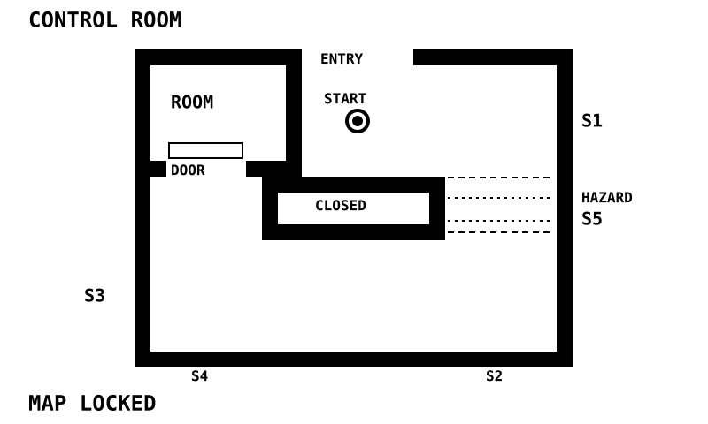

# v6 전자종이 지도 (흑백 800×480)

2026-11-25 · 사용자 요청: 지도 모양만 최종 제작도 v6과 일치시킨다. **실물 확인이 끝난 T075A04 흑백 드라이버, SPI 4 MHz, HOLD/A/H/U, BUSY·절전·UART 처리는 유지한다.**

위 그림은 실제 800×480 화면에 대응하는 벡터 미리보기이며 글꼴은 실제 Good Display 폰트와 약간 다를 수 있다. 실물 촬영본이 아니다. [실물 검증된 이전 흑백판](epaper-monochrome-fix.md) · [제작도 v6](foam-v6.md).

- 55×40 cm 바닥의 벽 14개, 14 cm 상단 입구, 중앙 폐쇄 공간, 목적지와 문, 복도 4개, 실제 S1~S5 방향별 위치를 기존 v6 좌표에 맞춰 표시한다. S4는 위로 돌아오는 마지막 복도다.
- 실제 흑백 패널이므로 위험구역은 검은 파선, 매우 위험한 띠는 짧은 점선으로 표시한다. 출발점은 이중 원, 실시간 위치는 빈 검은 링. 문은 평면도 닫힘 위치를 정적으로 표시하고 문 상태는 기존 하단 상태줄로 확인한다.
- 물리 좌표 mm(왼쪽 위 원점, +y 아래)를 화면에 동일 축척으로 매핑: x=152+round(0.9×x_mm), y=56+round(0.9×y_mm). 기존 site_profile의 유효 위치 검사 유지, 각 복도 명목 내부 범위에 대한 검사 추가. 실측 전 0 초기값은 변경하지 않는다. 센서 실측 후 두 보드를 함께 보정한다.
- 이전 HOLD 기록으로 새 지도가 건너뛰어지지 않도록 지도 버전 키를 hold-foam-v6으로 변경했다. 새 펌웨어 첫 부팅에 한 번 전체 갱신하고 이후 재부팅 유지 방식은 동일하다. 과거 펌웨어로 되돌리거나 실제 패널을 교체했다면 H를 한 번 보내 그림을 다시 표시한다.

## 검증 범위

좌표 기반 JS 검사 27/27 통과: 벽 14개 범위, 네 구간 중심 경로 끝점, 동일 축척, C4 위쪽 방향, 화면 구간 내 배치, 지도 버전 키 길이. 실제 Arduino 컴파일과 패널 업로드는 이번 작업에서 수행하지 않았다. 검증된 이전 펌웨어를 보존하고 새 지도는 현장에서 컴파일·표시·U 모드 시험한다.
