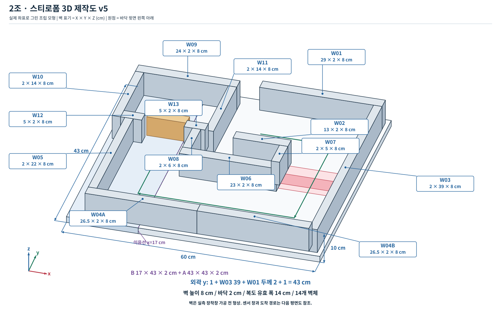

# 2026-11-25 모형 제작도 v5

**v5를 제작 기준으로 사용한다.** 이전 생성형 3D 그림은 벽 라벨과 실제 배치가 일치하지 않아 폐기한다. W06·W13·W12·W02를 오른쪽 외벽에 나열하면 46 cm로 43 cm를 초과한다. 실제 외벽은 W03(39 cm)이며, 바닥 여유 1 + W03 39 + W01 두께 2 + 여유 1 = 43 cm이다.

[전체 HTML](foam-v5.html) · [평면도](foam-v5-plan.svg) · [재단도](foam-v5-cut.svg) · [좌표 원본 JSON](foam-v5-geometry.json)

## 제작 기준

- 원판 43×43×2 cm 3장. A판 43×43 전량, B판 17×43로 절단하여 60×43 바닥 조립(x=17 이음선). B 잔여 25.8 cm 폭(절단 손실 0.2 가정)과 C판으로 14개 벽·문 재단. 벽 높이 8, 두께 2, 총 높이 10 cm.
- 기존 v3의 좌표 전체를 x 방향으로 9 cm 이동. 외곽 범위 x=1..59, y=1..42. 불필요한 바깥 여유를 줄였으며 내부 비이동 공간은 4구간 동선을 유지하기 위해 남긴다. 주변 1 cm는 조립 여유이며 센서 PCB/배선이 판 외부로 돌출될 수 있다.
- 벽 치수는 X×Y×Z. 복도 폭 14 cm, 세 코너 14×14 cm, 목적지실 20×12 cm. 5×5×6 cm 표적의 중심 경로 P0(33,33)→K1(50,33)→K2(50,10)→K3(13,10)→D(13,21), 88 cm.
- 문 축 (8.3,27.2), 문짝 9.4×2×6.5 cm, z=0.3..6.8, 90° 안쪽 개방. 이상 형상 최소 간격 0.2 cm이므로 실물 공차·경첩·서보 브라켓과의 간섭을 시험한다.

## 검산(독립 Python 프로세스, 29/29 통과)

벽 수 14, 모든 벽 바닥 이내, 91개 벽 쌍 겹침 없음, 두께 2, 외곽 여유 1, 오른쪽/아래쪽 벽 연쇄 치수, 바닥 이음, 복도 4개 폭, 5×5 표적 직각 이동과 경로 88, 문 회전 0~90°(0.1° 간격 901자세) 및 열린 문 통과, S1~S5 장착창 각각의 벽 안 포함, 부재 중복/누락 없음, B·C판 띠 폭 및 각 7개 재단 줄 길이, 총 면적. 재단 공칭 필요 면적 4671.2 cm² / 원판 5547 cm², 별도로 0.2 cm 절단 여유를 포함한 배치도 검증. 실제 판재, 센서 음파, 접합 강도는 검증 대상이 아니다. 별도 ChatGPT 세션을 실행한 것은 아니다.

## 펌웨어 반영 시 주의

제작도는 왼쪽 아래 원점, +y 위. 기존 소프트웨어는 왼쪽 위 원점, +y 아래, mm이다. 환산 x_mm=10*x_cm, y_mm=10*(43-y_cm), 방향 dy 반전. 아래는 설계 공칭값이며 site_profile.h에 곧바로 실측값처럼 넣지 않는다.

| 센서 | 도면 (x,y,z) cm | 측정 방향(도면) | 공칭 펌웨어 원점(mm) | GPIO TRIG/ECHO |
|---|---|---|---|---|
| S1 | 57,33,4 | -x | 570,100 | PC8/PA0 |
| S2 | 50,3,4 | +y | 500,400 | PC9/PA1 |
| S3 | 6,10,4 | +x | 60,330 | PC10/PA2 |
| S4 | 13,3,4 | +y | 130,400 | PC11/PA3 |
| S5 | 57,21,4 | -x | 570,220 | PC12/PB6 |

S5 위험 표시 x43..57, y18..25, 강조 y19.5..22.5. 물체 중심과 초음파 반사면은 다르며 5 cm 표적의 중심 오프셋 공칭 2.5 cm는 측정 후 보정. 코너에서 다중 후보·미측정 처리 검증. ESP32 기존 지도는 C4가 아래로 향하는 스케치일 수 있으므로 v5 실제 평면과 맞춰 좌표 변환 및 렌더링을 함께 검증한다. 현재 커밋은 문서만 변경하며 코드·DFU·기존 시험 결과를 수정하지 않는다.

[프로젝트 TODO](../TODO.md)
