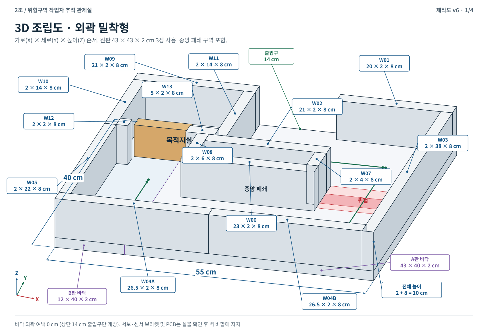
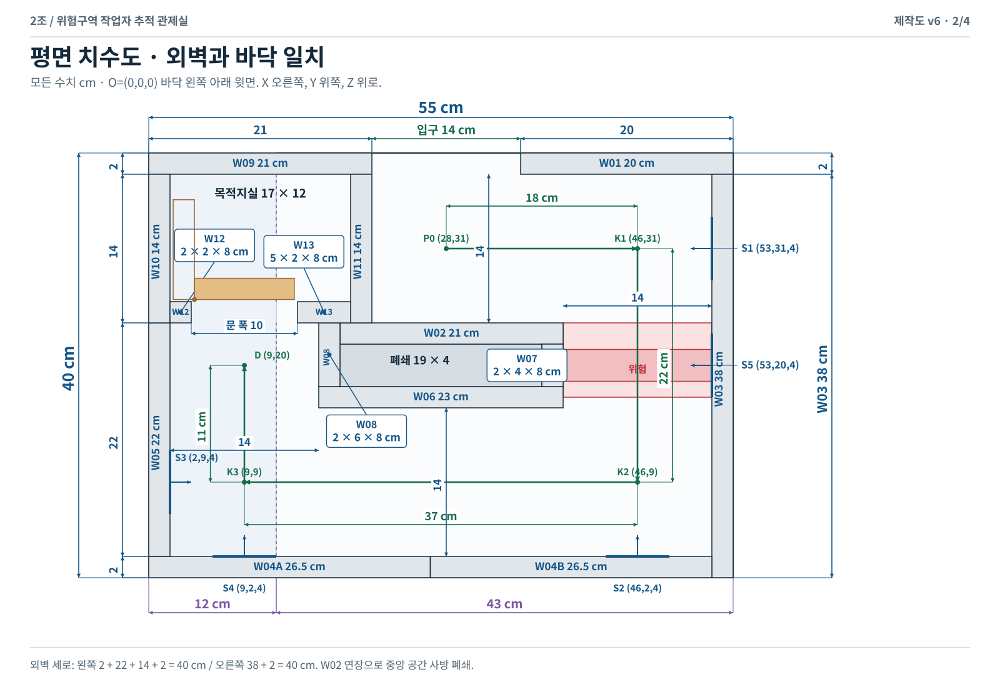

# 모형 제작도 v6 — 최종 확정

**2026-11-25 사용자 확정. v6이 유일한 최신 제작 기준이다. v3~v5 및 생성형 3D 이미지는 변경 이력이며 재단에 사용하지 않는다.**

[전체 확대·인쇄용 HTML](foam-v6.html) · [재단도](foam-v6-cut.svg) · [단면 및 문 상세도](foam-v6-detail.svg) · [좌표 원본 JSON](foam-v6-geometry.json)

## 최종 규격 및 제작

- 원판 43×43×2 cm 3장. A판을 43×40, B판을 12×40으로 재단하여 바닥 **55×40×2 cm** 조립. 이음선 x=12 cm. 절단 손실 0.2 cm 가정, B판 잔여 폭 30.8 cm 및 C판에서 벽·문 재단.
- 외벽과 바닥의 외곽이 일치한다. 왼쪽 Y: W04A 두께 2 + W05 22 + W10 14 + W09 두께 2 = 40 cm. W12는 W10과 동일 Y 구간이므로 추가하지 않는다. 오른쪽 Y: W03 38 + W01 두께 2 = 40 cm.
- 아래 X: W04A 26.5 + W04B 26.5 + W03 두께 2 = 55 cm. 위 X: W09 21 + 의도적인 출입구 14 + W01 20 = 55 cm. 외곽 여백 0 cm, 위쪽 14 cm 입구 외에는 모두 막는다.
- 중앙 W02·W06·W07·W08이 연결되어 19×4 cm 비사용 공간의 사방이 닫힌다. 지붕은 없는 모형이다.
- 벽 14개, 높이 8 cm, 두께 2 cm, 바닥 포함 총 높이 10 cm. 직선 복도 4개 폭 14 cm, 코너 3개. 목적지실 17×12 cm, 문 통과 폭 10 cm.
- 문: 9.4×2×6.5 cm, 회전축 (4.3,26.2), z=0.3~6.8 cm, 방 안쪽 90° 개방. 공칭 최소 여유 0.2 cm; 실제 경첩·서보 혼·브라켓·절단 공차는 실측하고 조립 시험한다.
- 재단 순서: C판 5줄, B판 잔여 2줄. 부재 공칭 면적 4,205.1 cm² / 원판 5,547 cm². 표적 5×5×6 cm. P0(28,31)→K1(46,31)→K2(46,9)→K3(9,9)→D(9,20), 중심 경로 88 cm.

## 좌표 검산

최종 HTML 원본과 좌표를 보존했다. 도면 생성과 분리된 Python 프로세스에서 48/48 항목 통과: 벽 91쌍 무겹침, 외곽 밀착 및 출입구, 중앙 19×4 공간 분리, 복도/코너, 표적 swept footprint, 센서 장착창, 문 회전 901자세 및 통과, 3장 재단·절단 여유. 실제 제작·센서 반사·모터·전원·e-Ink 동작은 별도 검증 대상이다. 독립 검산은 다른 ChatGPT 세션이 아니라 별도 Python 실행이다.

## 센서 및 지도 좌표

도면 원점은 왼쪽 아래 바닥 윗면, +Y 위, cm. 기존 펌웨어는 왼쪽 위 원점, +Y 아래, mm. x_mm=10*x_cm, y_mm=10*(40-y_cm), dy 부호 반전.

| 센서 | 도면 XYZ(cm) | 방향 | 펌웨어 공칭 XY(mm) | TRIG/ECHO |
|---|---|---|---|---|
| S1 | (53,31,4) | -X | (530,90) | PC8/PA0 |
| S2 | (46,2,4) | +Y | (460,380) | PC9/PA1 |
| S3 | (2,9,4) | +X | (20,310) | PC10/PA2 |
| S4 | (9,2,4) | +Y | (90,380) | PC11/PA3 |
| S5 | (53,20,4) | -X | (530,200) | PC12/PB6 |

위험구역 표시 x39~53, y17~24, 매우 위험 표시 y18.5~21.5. S1/S5는 W03, S2 W04B, S3 W05, S4 W04A. 센서 장착창 6×3 cm(z2.5~5.5), 벽 관통 2 cm는 공칭 여유안이다. PCB와 배선의 외부 돌출 공간은 별도 확보한다. 실제 센서 앞면, 배경 거리, 반사면-중심 오프셋, 유효 범위, 경보 임계값과 서보 끝점 확인 전 site_profile을 활성화하지 않는다. 양쪽 보드 지도 좌표와 C4 진행 방향은 실측 후 함께 적용한다.

이번 커밋은 문서·도면 갱신만 수행하며 기존 펌웨어 변경 및 시험 기록은 보존한다. [최신 TODO](../TODO.md).
