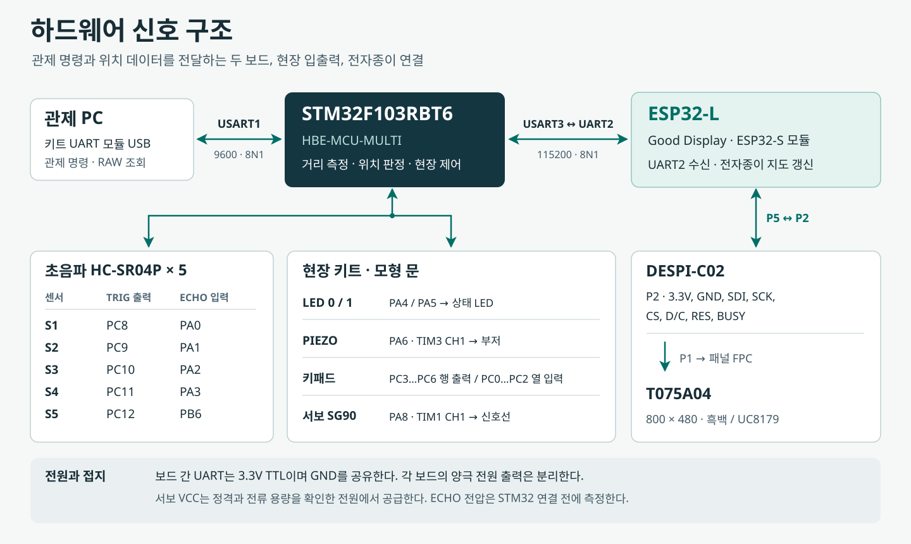
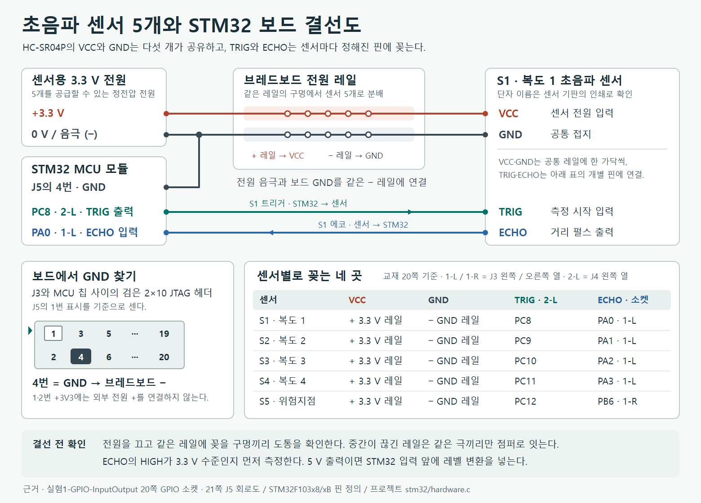
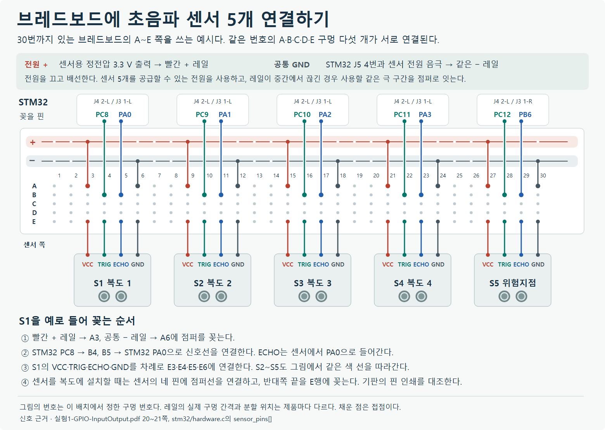
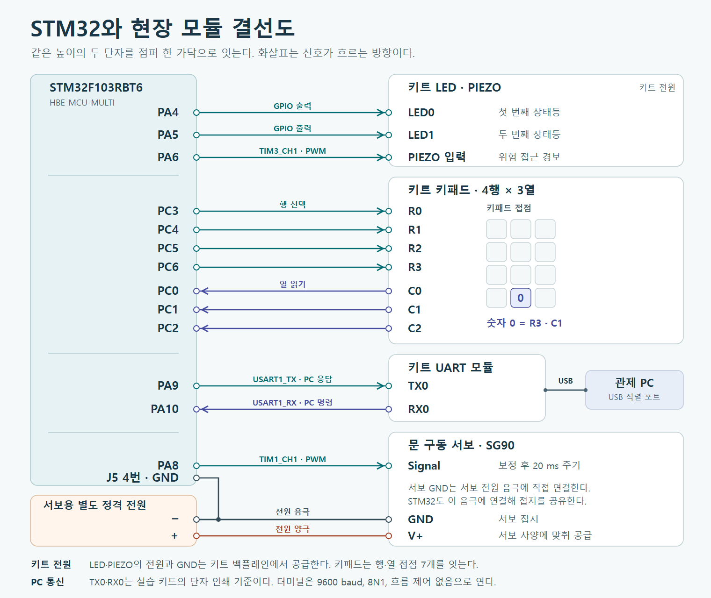
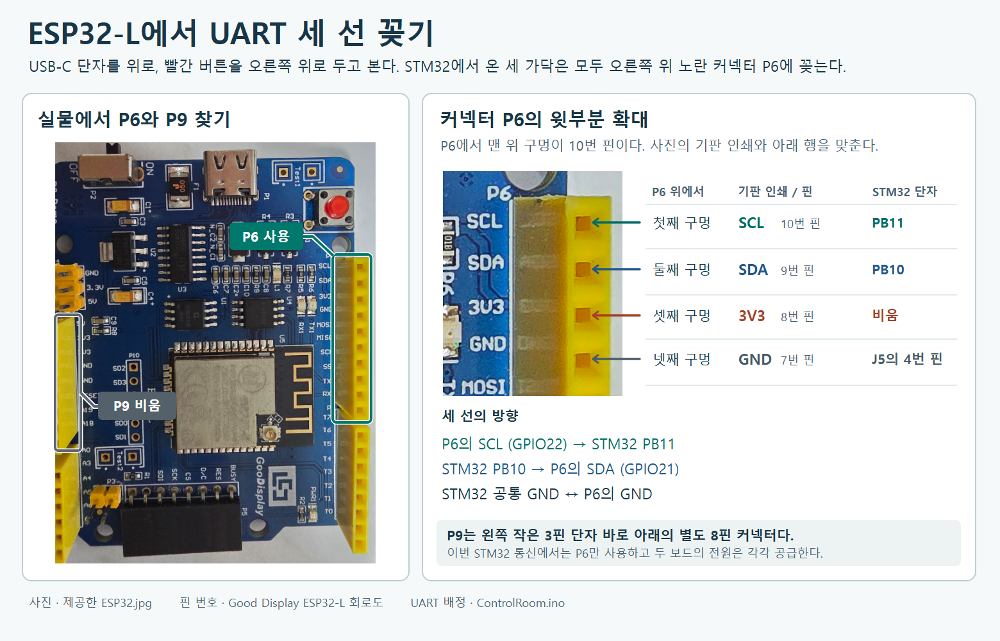
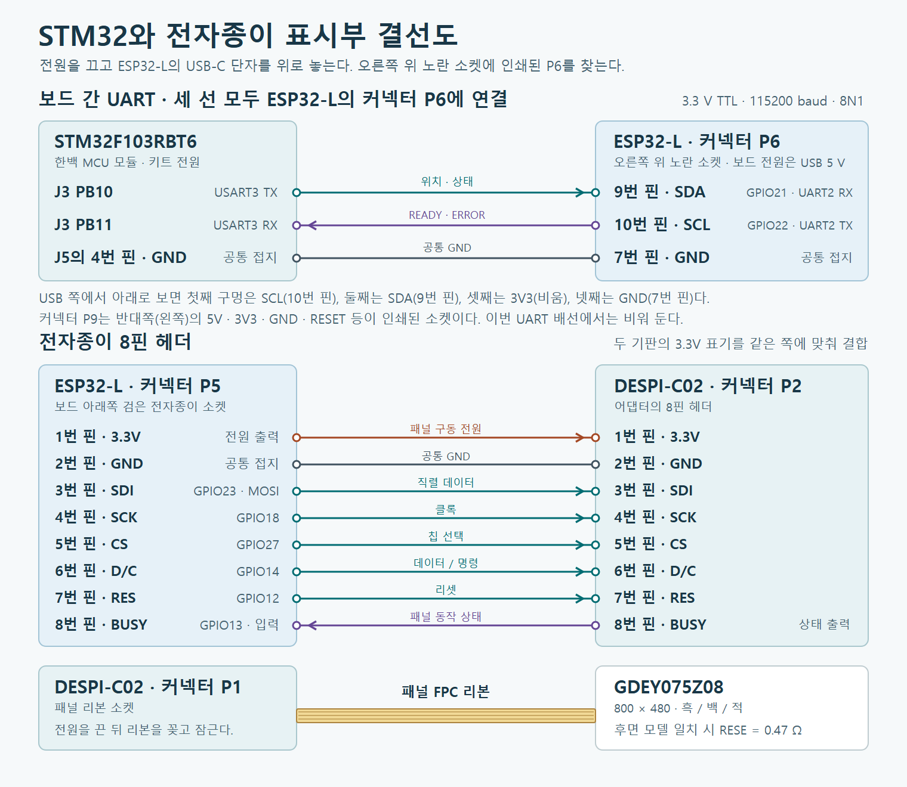
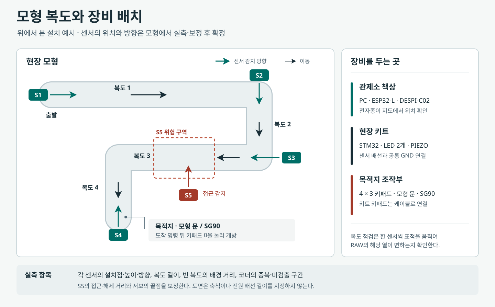

# 하드웨어 연결과 배치

한백전자 HBE-MCU-MULTI의 STM32F103RBT6가 초음파 센서 5개를 읽고 LED·피에조·문 서보를 제어한다. PC는 관제 명령을 보내고, Good Display ESP32-L은 STM32에서 받은 위치와 상태를 전자종이에 표시한다.

처음 조립할 때는 [처음부터 따라 하기](처음부터_따라하기.html)를 브라우저로 연다. 이미지를 내장해 인터넷 연결 없이도 배선, 보드 다운로드, 센서 확인, 보정 순서를 볼 수 있다.

## 초음파 센서 S1~S5

[확대용 SVG 결선도](ultrasonic-wiring.svg)

위 예시는 S1의 VCC·TRIG·ECHO·GND 점퍼를 브레드보드 **E3·E4·E5·E6**에 꽂는다. 빨간 + 레일에서 A3, 공통 − 레일에서 A6으로 점퍼를 놓고 B4에 PC8, B5에 PA0을 연결한다. S2는 E9~E12, S3은 E15~E18, S4는 E21~E24, S5는 E27~E30을 쓴다. 각 센서의 실제 핀 표기를 확인한다. [브레드보드 결선도 확대](breadboard-wiring.svg)

**GND는 다섯 센서가 한 줄을 공유한다.** 전원을 끄고 STM32 모듈의 JTAG 헤더가 비어 있을 때 **J5 4번(GND)**에서 브레드보드 파란 `−` 레일로 점퍼 한 가닥을 꽂는다. 센서 5개의 `GND`와 센서 전원의 `−`를 모두 이 레일에 꽂는다. J5는 왼쪽 GPIO 소켓과 MCU 칩 사이의 검은 2×10 JTAG 헤더다. 기판의 **1번 표시**를 찾으면 맞은편이 2번이고, 2번과 같은 열의 바로 다음 핀이 **4번**이다. 레일이 중간에 끊긴 브레드보드는 전원을 끈 상태에서 도통을 확인하고, 사용할 구간끼리 같은 극을 잇는다.

**VCC는 3.3 V 레일을 공유한다.** 3.3 V 구동형 HC-SR04P를 기준으로, 센서 5개를 공급할 용량이 확인된 정전압 3.3 V 출력의 `+`를 빨간 `+` 레일에 연결하고 각 센서의 `VCC`를 그 레일에 꽂는다. J5 1·2번에는 보드의 +3.3 V가 걸려 있다. 센서 5개를 공급할 수 있는 전류는 실습자료에 명시되어 있지 않다. 별도 전원을 쓸 때 그 양극은 센서 레일에만 연결한다. 실제 센서의 핀 인쇄를 확인하고, STM32에 ECHO를 꽂기 전에 오실로스코프로 펄스의 HIGH 전압을 확인한다. [선정한 HC-SR04P 사양 및 핀 사진](https://www.devicemart.co.kr/goods/view?no=1323062)

**신호선은 센서마다 따로 꽂는다.** 모듈의 빨간 RESET 버튼을 오른쪽 아래에 두면, S1~S5의 TRIG는 오른쪽 GPIO 헤더 J4의 왼쪽 열(Socket 2-L), S1~S4의 ECHO는 왼쪽 GPIO 헤더 J3의 왼쪽 열(Socket 1-L), S5의 ECHO는 J3의 오른쪽 열(Socket 1-R)에 있다. 예를 들어 S1은 `PC8 → TRIG`, `ECHO → PA0` 표기 위치에 꽂는다. 소켓 위치와 J5 번호의 출처는 키트 실습자료 `실험1-GPIO-InputOutput.pdf` 20쪽 사진과 21쪽 회로도다.

각 센서에는 VCC, GND, TRIG, ECHO 네 선이 필요하다. TRIG는 STM32 출력, ECHO는 STM32 입력이다. 아래 포트명은 기판에 인쇄된 이름이며, 펌웨어는 `sensor_pins[]` 표에서 GPIO 초기화와 입력 캡처에 쓸 핀을 가져온다. [STM32 센서 핀 정의](../stm32/hardware.c)

| 센서 | 측정 대상 | 센서 VCC | STM32 → TRIG | ECHO → STM32 | 입력 캡처 | `RAW` 거리 열 |
| --- | --- | --- | --- | --- | --- | --- |
| S1 | 복도 1 | **3.3 V** | PC8 | PA0 | TIM2_CH1 | 1 |
| S2 | 복도 2 | **3.3 V** | PC9 | PA1 | TIM2_CH2 | 2 |
| S3 | 복도 3 | **3.3 V** | PC10 | PA2 | TIM2_CH3 | 3 |
| S4 | 복도 4 | **3.3 V** | PC11 | PA3 | TIM2_CH4 | 4 |
| S5 | 위험지점 접근 | **3.3 V** | PC12 | PB6 | TIM4_CH1 | 5 |

초음파 간섭을 줄이기 위해 `S5 → S1 → S5 → S2 → S5 → S3 → S5 → S4` 순서로 한 개씩 구동한다. 현재 설정은 슬롯당 60 ms, TRIG 약 10 µs, ECHO 마감 30 ms다. S5는 약 120 ms, 각 복도 센서는 약 480 ms 간격으로 측정한다. [측정 순서](../stm32/main.c) · [GPIO·타이머와 ECHO 처리](../stm32/hardware.c) · [시간 설정](../stm32/station.h)

## PC·표시 보드·현장 모듈

[현장 모듈별 결선도 확대](field-modules.svg)

ESP32-L은 부품 면의 USB-C가 위를 향하도록 놓는다. 오른쪽 빨간 버튼 바로 아래 노란 10구 소켓이 **커넥터 P6**다. STM32에서 오는 세 가닥은 이곳에 꽂는다. 왼쪽의 작은 3구 소켓 아래에는 별도의 노란 8구 **커넥터 P9**가 있다. 이번 UART 배선에서는 P9를 비워 둔다.

| 보내는 쪽 | 받는 쪽 | 신호 및 용도 |
| --- | --- | --- |
| STM32 PA9 | 키트 UART 모듈 TX0 | USART1_TX, PC 응답 |
| 키트 UART 모듈 RX0 | STM32 PA10 | USART1_RX, PC 명령 |
| STM32 PB10 | 커넥터 P6 위에서 둘째 **SDA** (9번 핀, GPIO21) | USART3_TX → UART2_RX, 위치·상태 |
| 커넥터 P6 위에서 첫째 **SCL** (10번 핀, GPIO22) | STM32 PB11 | UART2_TX → USART3_RX, `READY`·`ERROR` |
| STM32 GND | 커넥터 P6 위에서 넷째 **GND** (7번 핀) | 공통 접지. 바로 위 셋째 **3V3** (8번 핀)는 비움 |
| STM32 PA4 / PA5 | 키트 LED0 / LED1 | 관제 상태 표시, HIGH일 때 점등 |
| STM32 PA6 | 키트 PIEZO 입력 | TIM3_CH1, 위험지점 경보 |
| STM32 PA8 | SG90 Signal | TIM1_CH1, 실제 끝점 보정 후 20 ms 주기 PWM |
| STM32 PC3 / PC4 / PC5 / PC6 | 키패드 R0 / R1 / R2 / R3 | 행을 하나씩 선택 |
| 키패드 C0 / C1 / C2 | STM32 PC0 / PC1 / PC2 | 열을 읽음. 숫자 0은 R3·C1 |

PC는 키트 UART 모듈의 USB 직렬 단자를 **9600 baud, 8N1, 흐름제어 없음**으로 연다. 표의 TX0·RX0는 이 키트의 단자 표기다. 보드 간 UART는 **3.3 V TTL, 115200 baud, 8N1**이다. P6의 SDA·SCL은 ESP32 펌웨어에서 UART2에 배정한다. [STM32 직렬 설정](../stm32/serial.c) · [ESP32 직렬 설정](../esp32/ControlRoom/ControlRoom.ino) · [ESP32-L 제조사 회로도](https://www.good-display.com/companyfile/909.html)

## ESP32-L P5와 DESPI-C02 P2

[ESP32 및 전자종이 결선도 확대](display-wiring.svg)

두 기판의 **3.3V 표시끼리** 맞춘다. 다음 표는 각 기판의 3.3V 쪽에서 시작하는 신호 순서다. DESPI-C02의 P1에는 패널 리본을 연결한다.

| 순서 | ESP32-L P5 ↔ DESPI-C02 P2 | ESP32 핀 | 방향 |
| --- | --- | --- | --- |
| 1 | 3.3V | 3.3 V 전원 | 기판 → 어댑터 |
| 2 | GND | GND | 공통 |
| 3 | SDI | GPIO23 / MOSI | 기판 → 어댑터 |
| 4 | SCK | GPIO18 | 기판 → 어댑터 |
| 5 | CS | GPIO27 | 기판 → 어댑터 |
| 6 | D/C | GPIO14 | 기판 → 어댑터 |
| 7 | RES | GPIO12 | 기판 → 어댑터 |
| 8 | BUSY | GPIO13 | 어댑터 → 기판 |

사진에서 확인한 기판은 ESP32-L과 DESPI-C02다. 펌웨어 대상은 계획서에 지정한 800 × 480 삼색 **GDEY075Z08**이다. 실물 패널 라벨이 해당 모델이면 RESE를 **0.47 Ω**에 둔다. [ESP32 화면 초기화 코드](../esp32/ControlRoom/panel.cpp) · [패널 사양](https://www.good-display.com/product/394.html) · [제조사 RESE 선택표 §4.3](https://v4.cecdn.yun300.cn/100001_1909185148/Evaluation%20Kit%20for%20E-Paper%20Display%20DEArduino-L%28C02%29.pdf)

## 배치와 전원

| 모듈 | 전원을 연결하는 곳 |
| --- | --- |
| HC-SR04P S1~S5 | 센서 5개 모두 VCC는 같은 **3.3 V** 레일, GND는 같은 − 레일에 꽂는다. |
| STM32 / LED / PIEZO / 키트 UART | 키트의 기존 전원을 사용한다. LED·피에조·UART 모듈에는 그림에 표시한 신호선을 잇는다. 키패드는 행·열 7가닥을 연결한다. |
| ESP32-L | 보드의 USB Type-C로 **5 V**를 공급한다. STM32와 연결하는 UART 신호는 3.3 V다. |
| DESPI-C02 / 전자종이 | ESP32-L 커넥터 P5의 1번 핀(`3.3V`)에서 어댑터 커넥터 P2의 1번 핀(`3.3V`)으로 전원을 공급한다. 패널 리본은 어댑터 커넥터 P1에 꽂는다. |
| SG90 서보 | 제품 정격에 맞는 별도 전원에 V+와 GND를 연결한다. TowerPro SG90 Digital의 공칭 동작 전압은 **4.8 V**다. 지급품의 정격 범위가 5 V를 포함할 때만 5 V 전원을 쓴다. [TowerPro 사양](https://towerpro.com.tw/product/sg90-7/) |

- S1·S3은 수평, S2·S4는 수직 복도의 표적을 향한다. S5는 별도로 위험지점 접근을 측정한다. 그림은 배치 예시이며 센서 원점, 거리, 방향, 가림 구간은 실제 모형에서 잰다.
- 센서 VCC는 사용 모듈의 정격을 확인한 전원 레일에, GND는 STM32 GND에 연결한다. 계획서의 HC-SR04P는 3.3 V 공급·ECHO 실측을 전제로 한다. PA0~PA3은 5 V 허용 핀으로 지정되어 있지 않으므로 ECHO가 5 V인 모듈에는 3.3 V 레벨 변환이 필요하다. [STM32F103RB 데이터시트 Table 5](https://www.st.com/resource/en/datasheet/stm32f103rb.pdf)
- 서보 전원은 제품 정격과 구동 전류를 충족하는 전원 레일에서 공급한다. PA8에는 신호선만 연결한다. STM32·서보·센서·표시 보드의 GND를 공통으로 하고, 각 보드 전원의 양극 출력은 분리한다.

## 현장에서 처음 확인할 순서

1. 전원을 끄고 센서 번호와 케이블 양 끝을 대조한다. ECHO 입력을 연결하기 전에 센서 출력 전압을 측정한다.
2. PC 터미널에서 `RAW`와 Enter를 보낸다. 응답은 `R,S1_mm,S2_mm,S3_mm,S4_mm,S5_mm`이며 보정 전에도 읽을 수 있다. 미측정·시간 초과는 `-1`이다.
3. 평평한 표적을 S1부터 S5까지 하나씩 옮기며 `RAW`를 반복한다. 해당 열의 거리 변화와 줄자 실측값을 기록한다. 한 센서의 ECHO 연결을 해제한 경우 해당 열은 `-1`로 갱신되고 다른 센서는 계속 측정되어야 한다. 배선을 바꿀 때는 전원을 끈다.
4. 빈 복도와 표적 거리를 비교해 구간별 보정값을 정하고, S5 경보 거리와 서보 펄스 폭을 실측해 입력한다. 보정 후 양쪽 펌웨어를 다시 빌드한다. 기본 설정은 위치 미확인, 경보 `UNKNOWN`, 문 `UNSET`이다. [보정 항목](../stm32/site_profile.h) · [빌드와 시험 현황](프로젝트_진행현황.md)
