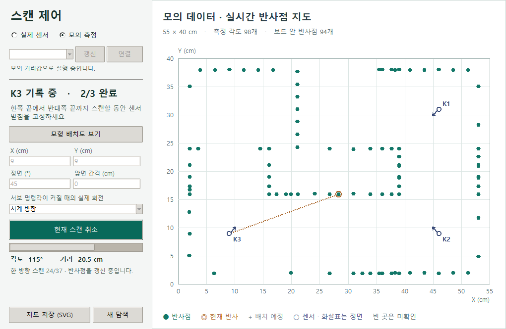

# PC 실시간 초음파 지도

서보 위의 센서 한 개를 스티로폼 모형의 **K1 → K2 → K3**에 차례로 놓는다. 기록을 누르면 PC가 STM32에서 보내는 각도와 거리를 받아 같은 지도에 반사점을 찍는다. 오른쪽의 점선은 가장 최근에 보드 안에서 받은 반사를 가리킨다. 아래 화면은 v6 벽 배치로 만든 **모의 측정** 예시다.



## 실행

Windows PowerShell에서 프로젝트 폴더로 이동해 실행한다.

```powershell
cd C:\mcu_project\project
.\pc_mapper\start-mapper.cmd
```

파일 탐색기에서 `pc_mapper\start-mapper.cmd`를 더블클릭해도 된다. Windows용 Python 3.10 이상과 Tcl/Tk를 사용하며 별도의 pip 패키지는 필요 없다. Python 런처가 설치된 PC에서는 `py -3 pc_mapper\app.py`로도 실행할 수 있다.

## 센서 연결과 기록

1. **STM32를 스캔 모드로 켠다.** 기존 `SweepScan.dfu`가 서보를 왕복시키며 UART로 측정값을 보낸다. 이 펌웨어를 이미 실행 중이면 그대로 사용한다. [스캔 펌웨어와 배선](../README.md#배선)
2. **PC에 UART를 연결한다.** 키트 UART 모듈은 **PB10 → 키트에 TX0라고 적힌 단자**로 점퍼를 연결한다. 별도 3.3 V USB–TTL 어댑터를 쓰면 **PB10 → 어댑터 RX**, **키트 GND → 어댑터 GND**로 연결한다. PC에는 사용하는 UART 모듈 또는 어댑터의 USB 케이블을 꽂는다. DfuSe에 사용한 DFU 연결과 측정용 COM 포트는 별개다. GUI에서 **실제 센서 → 갱신 → 해당 COM 포트 → 연결**을 누른다. 같은 포트를 연 시리얼 터미널은 먼저 닫는다.
3. **K1에 고정하고 기록한다.** 회전축의 위치와 서보 90°에서의 센서 정면을 아래 표에 맞춘다. 센서 앞면은 벽을 향해 수평으로 놓는다. **K1 기록 시작**을 누르면 첫 유효 반사부터 바로 보인다. 서보가 이미 움직이는 중이어도 된다.
4. **자동 정지 후 옮긴다.** 0°에서 180° 또는 역방향으로 5°마다 받은 연속 37개 프레임이 한 꼭짓점의 기록이다. 시작 직후의 부분 스캔은 미리 보여주고, 완주하면 해당 꼭짓점의 점을 완주 데이터로 확정한다. 화면이 **K2 배치**로 바뀐 뒤 옮기고 **K2 기록 시작**을 누른다. K3도 반복한다. 이동 중에도 펌웨어는 왕복하지만, GUI는 다음 기록 버튼을 누를 때까지 거리를 지도에 추가하지 않는다.
5. **지도를 저장한다.** 세 꼭짓점이 끝나면 합쳐진 지도가 그대로 남는다. **지도 저장 (SVG)**으로 현재 화면을 저장해 브라우저에서 다시 보거나 인쇄할 수 있다. 측정 도중의 지도도 저장할 수 있다.

## 꼭짓점과 서보 방향 맞추기

**K1·K2·K3는 통로 바닥의 중심선이 방향을 바꾸는 세 곳**이다. 출발점 P0에서 오른쪽으로 18 cm 가면 K1, 거기서 아래로 22 cm 가면 K2, K2에서 왼쪽으로 37 cm 가면 K3다. 아래 그림에서 표시한 곳에 서보 회전축을 놓는다. GUI의 **모형 배치도 보기** 버튼으로도 이 그림을 열 수 있다.


모형 크기는 55 × 40 cm다. 위에서 볼 때 왼쪽 아래가 (0, 0), 오른쪽이 +X, 위쪽이 +Y다. 아래 좌표는 v6 경로의 세 꺾임점이며, 정면 방향은 각 꺾임에서 양쪽 복도를 보도록 정한 기본 설치값이다. **회전축을** 해당 위치에 놓고 **서보 90°일 때** 센서가 표의 방향 표시를 바라보도록 받침을 돌린다. RESET 직후 스캔 펌웨어가 약 3초간 정면을 유지해 방향을 확인할 수 있다. [v6 제작 도면](https://github.com/tokengeoji/mcu/blob/save/docs/foam-v6.md)

| 기록 위치 | 회전축 (X, Y) cm | 서보 90° 정면 | 받침에 정면 화살표를 그릴 때 향할 점 (cm) |
| --- | --- | --- | --- |
| K1 | (46, 31) | ↙ 왼쪽 아래 · 225° | (41, 26) |
| K2 | (46, 9) | ↖ 왼쪽 위 · 135° | (41, 14) |
| K3 | (9, 9) | ↗ 오른쪽 위 · 45° | (14, 14) |

받침을 다른 위치에 두면 GUI의 **X, Y, 정면**에 실측값을 입력한다. **앞면 간격**은 회전축 중심에서 초음파 센서 앞면까지 정면 방향으로 잰 거리(cm)다. 기본값은 0이다. 예를 들어 센서 앞면이 축보다 2 cm 앞에 있으면 2를 입력한다. 위에서 볼 때 명령각 90°→180°에서 센서가 도는 방향을 확인해 **시계 방향** 또는 **반시계 방향**을 선택한다. 실제 서보의 정면과 회전 범위가 명령각과 다르면 지도에도 그 오차가 나타난다.

## 표시 기준과 확인 방법

- 펌웨어의 `SCAN,42,1,90,201`은 순번 42, 부저 상태 1, 명령각 90°, 거리 201 mm다. PC는 부저 상태와 관계없이 유효 거리 **20~4000 mm**를 반영한다. **무응답(-1)**과 보드 밖의 반사는 지도에 점을 찍지 않는다. 빈 곳은 아직 확인하지 못한 영역이다.
- 각 점은 초음파가 처음 반사된 곳을 **빔 중심 방향으로 추정한 위치**다. 점을 이어 벽으로 확정하지 않는다. 지도가 좌우 반대로 보이면 서보 회전 방향을, 전체가 틀어졌으면 받침 정면과 축 좌표를 먼저 확인한다.
- 5초 동안 정상 프레임이 없으면 화면에 안내가 뜬다. 각도가 계속 90°에 머물면 스캔용 `SweepScan.dfu`를 확인한다. 유효한 반사가 한 번도 없는 패스는 같은 위치에서 다시 기록한다. 연결이 끊기거나 **현재 스캔 취소**를 누르면 해당 꼭짓점의 임시 점을 지우고 앞서 완료한 꼭짓점은 보존한다.
- 장비 없이 보려면 **모의 측정 → K1 기록 시작**을 누른다. K2와 K3도 같은 방식으로 이어서 확인한다. 모의 실행에서만 v6 벽으로 거리값을 생성하며 실제 측정과 파일 이름·지도 제목을 구분한다.
