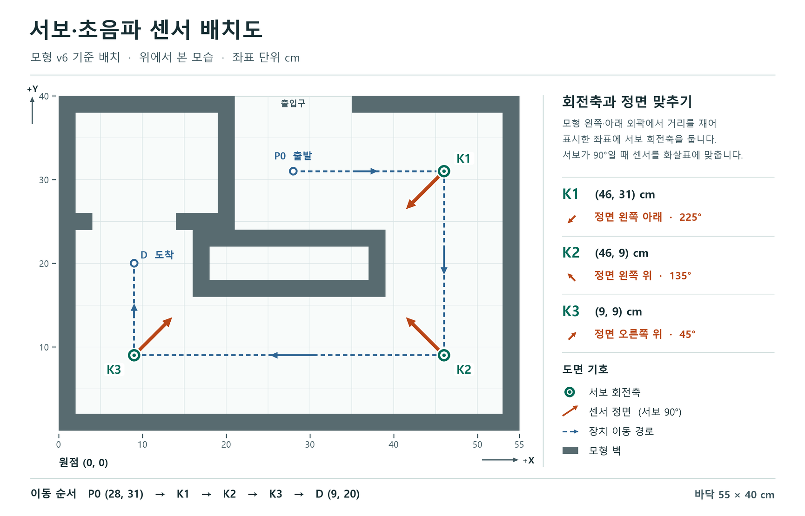

# PC 실시간 초음파 지도

센서를 스티로폼 모형의 **K1·K2·K3** 중 원하는 곳에 놓고 **실습판 키패드의 1·2·3** 중 해당 숫자를 한 번 누른다. 그때 서보가 움직이고 PC 지도에 각도별 반사점이 쌓인다. 주황 점선은 가장 최근에 보드 안에서 받은 반사를 가리킨다. 아래 화면은 v6 벽 배치로 만든 **모의 측정** 예시다.


## 실행

Windows PowerShell에서 프로젝트 폴더로 이동해 실행한다.

```powershell
cd C:\mcu_project\project
.\pc_mapper\start-mapper.cmd
```

파일 탐색기에서 `pc_mapper\start-mapper.cmd`를 더블클릭해도 된다. Windows용 Python 3.10 이상과 Tcl/Tk를 사용하며 별도의 pip 패키지는 필요 없다. Python 런처가 설치된 PC에서는 `py -3 pc_mapper\app.py`로도 실행할 수 있다.

## 센서 연결과 기록

1. **키패드용 펌웨어를 올린다.** 전원을 끄고 키패드를 연결한 뒤 DfuSe에서 이번 버전의 `firmware/SweepScan.dfu`를 전송하고 RESET을 누른다. 서보가 정면에 대기한다. 이전 자동 왕복 펌웨어는 지점 번호를 보내지 않는다. [키패드 배선도](../docs/keypad-wiring.svg) · [서보 배선 및 끝각 보정법](../README.md#왼쪽이-짧을-때-서보-끝각-맞추기)
2. **PC에 UART를 연결한다.** 키트 UART 모듈은 **PB10 → 키트 TX0**, 별도 3.3 V USB–TTL 어댑터는 **PB10 → 어댑터 RX**와 **키트 GND → 어댑터 GND**로 연결한다. UART 모듈 또는 어댑터의 USB 케이블을 PC에 꽂는다. 지도 앱을 열고 COM 포트가 여러 개면 **연결** 메뉴에서 해당 포트를 고른다. 포트가 하나면 자동 연결한다. 이전 GUI와 시리얼 터미널은 먼저 닫는다.
3. **원하는 지점에서 키를 누른다.** 예를 들어 K1에 회전축과 정면을 맞추고 실제 키패드 **1**을 누른다. 서보가 한쪽 끝으로 이동하고 첫 각도에서부터 점이 표시된다. K2는 **2**, K3는 **3**이다. 어느 지점에서든 시작할 수 있다.
4. **완료 후 옮긴다.** 0° → 180°를 5° 간격으로 한 번 측정하면(37개 각도) 서보가 90°로 돌아온다. GUI 하단에 지점 완료가 표시된 뒤 다음 위치로 옮긴다. 같은 지점을 다시 누르면 새 스캔이 끝났을 때 그 지점만 갱신한다. 스캔 중 누른 다른 키는 예약되지 않는다.
5. **지도 → SVG 저장**으로 현재 화면을 저장할 수 있다. 보이는 점의 좌표를 포함한 파일을 브라우저에서 열거나 인쇄할 수 있다.

## 꼭짓점과 서보 방향 맞추기

**K1·K2·K3는 통로 바닥의 중심선이 방향을 바꾸는 세 곳**이다. 출발점 P0에서 오른쪽으로 18 cm 가면 K1, 거기서 아래로 22 cm 가면 K2, K2에서 왼쪽으로 37 cm 가면 K3다. 아래 그림에서 표시한 곳에 서보 회전축을 놓는다. GUI의 **도움말 → 모형 배치도**에서도 이 그림을 열 수 있다.



모형 크기는 55 × 40 cm다. 위에서 볼 때 왼쪽 아래가 (0, 0), 오른쪽이 +X, 위쪽이 +Y다. 아래 좌표는 v6 경로의 세 꺾임점이며, 정면 방향은 각 꺾임에서 양쪽 복도를 보도록 정한 기본 설치값이다. **회전축을** 해당 위치에 놓고 **서보가 정면 90°에 대기할 때** 센서가 표의 방향 표시를 바라보도록 받침을 돌린다. [v6 제작 도면](https://github.com/tokengeoji/mcu/blob/save/docs/foam-v6.md)

| 기록 위치 | 회전축 (X, Y) cm | 서보 90° 정면 | 받침에 정면 화살표를 그릴 때 향할 점 (cm) |
| --- | --- | --- | --- |
| K1 | (46, 31) | ↙ 왼쪽 아래 · 225° | (41, 26) |
| K2 | (46, 9) | ↖ 왼쪽 위 · 135° | (41, 14) |
| K3 | (9, 9) | ↗ 오른쪽 위 · 45° | (14, 14) |

받침을 다른 위치에 두면 GUI의 **설정 → 센서 배치 보정**에서 지점별 X·Y·정면을 바꾼다. 앞면 간격은 회전축에서 센서 앞면까지의 거리(cm)다. 기본값은 0이다. 위에서 볼 때 명령각 90°→180°에서 센서가 도는 방향도 맞춘다. 실제 서보의 끝각을 바꿀 때는 위의 키패드 서보 보정 절차를 사용한다.

## 표시 기준과 확인 방법

- 펌웨어의 `SCAN,42,1,90,201`은 순번 42, 부저 상태 1, 명령각 90°, 거리 201 mm다. PC는 부저 상태와 관계없이 유효 거리 **20~4000 mm**를 반영한다. **무응답(-1)**과 보드 밖의 반사는 지도에 점을 찍지 않는다. 빈 곳은 아직 확인하지 못한 영역이다.
- 각 점은 초음파가 처음 반사된 곳을 **빔 중심 방향으로 추정한 위치**다. 점을 이어 벽으로 확정하지 않는다. 지도가 좌우 반대로 보이면 서보 회전 방향을, 전체가 틀어졌으면 받침 정면과 축 좌표를 먼저 확인한다.
- PC는 `BEGIN,K1`부터 해당 지점의 임시 점을 표시하고, 37개 연속 프레임과 `END,K1`을 받으면 확정한다. 스캔 도중 연결이 끊기거나 프레임 누락·전부 무응답이 발생하면 화면에 사유가 뜬다. 같은 지점에서 키를 다시 누르면 된다. 앞서 완료된 측정은 보존한다.
- 장비 없이 보려면 **설정 → 모의 입력**을 선택한 뒤 PC 숫자 키 1·2·3을 누른다. 이 모드에서만 v6 벽으로 거리값을 생성하며 지도와 SVG에 모의 실행이라고 표시한다.
